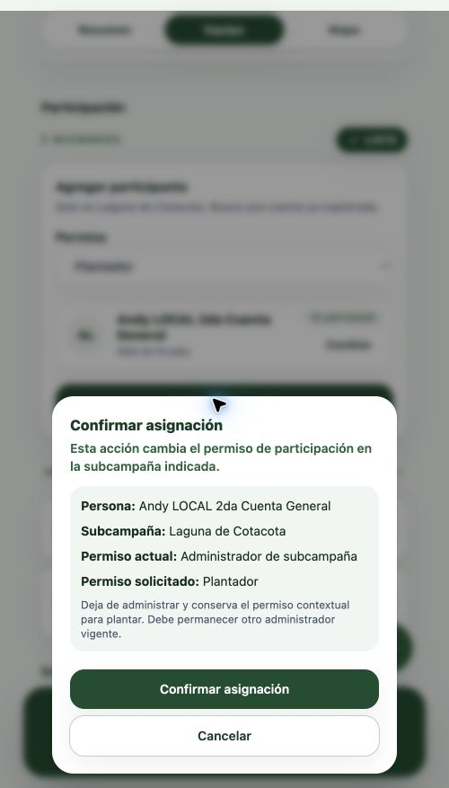

# Cambio de administrador a plantador desde Equipo

Fecha: 27 de octubre de 2026. Hallazgo AUD-026.

## Causa y corrección

Equipo permitía solicitar Plantador para una persona con permiso `ADMINISTRADOR_SUBCAMPANIA`, pero `AgregarParticipanteEquipo` siempre construía C04 `OTORGAR_PLANTADOR`. El rechazo `409 TIPO_PERMISO_INCOMPATIBLE` es el comportamiento contratado de C04.

El formulario ahora resuelve el comando a partir de la revisión de accesos consultada para la persona y la subcampaña actual:

| Permiso actual | Permiso solicitado | Comando |
| --- | --- | --- |
| Sin permiso o PLANTADOR | Plantador | C04 `OTORGAR_PLANTADOR` |
| ADMINISTRADOR_SUBCAMPANIA | Plantador | C07 `CAMBIAR_ADMINISTRADOR_A_PLANTADOR` |
| Cualquiera | Administrador de subcampaña | C06 `DESIGNAR_ADMINISTRADOR` |

C07 requiere ADMIN global, capacidad global de gestión de administradores y `acciones.cambiar_administrador`. El diálogo comunica que deja de administrar y que debe permanecer otro administrador vigente; si la persona conserva acceso global, también lo advierte. Falta de autoridad bloquea el botón y el manejador. UUID, revisión BIGINT exacta y recuperación pertenecen al comando definitivo conservado antes del POST. No hay designación/retiro separados ni fallback de C07 a C04 ante rechazo.

Contrato cotejado: §5.3 de `../r3foresta-docs/specs/plantacion/participacion-aliada/contrato-identidad-permisos-backend-propuesta.md`, controlador `../Backend-r3foresta/src/participacion/participacion-comandos.controller.ts` y migraciones 072/073. La protección del último administrador y los conflictos de revisión siguen siendo transaccionales del backend.

## Verificación ejecutada

- `npm run test -- src/modules/participacion/components/ParticipacionDetalleEquipo.test.tsx src/modules/participacion/api/participacion.api.test.ts`: 40 pruebas aprobadas. Incluyen C07, autorización, aviso de acceso global, cancelar/reconsultar, último administrador, revisión obsoleta y recuperación del mismo intento tras perder la respuesta. El cliente HTTP verifica `POST /api/v1/participacion/accesos/administrador-a-plantador` y GET con la misma operación.
- `npm run test`: 59 archivos / 863 pruebas aprobadas. La primera ejecución detectó tres fallos por dos expectativas antiguas de «Todavía no hay participantes» en `ParticipantHomeScreen.test.tsx`; se alinearon al texto ya existente «Todavía no hay participantes asignados», conservando las comprobaciones de autorización/paginación/cancelación.
- `npm run lint`: aprobado.
- `npm run build`: aprobado, incluye TypeScript y PWA. Conserva el aviso conocido del chunk MapLibre mayor de 1000 kB.

## Revisión de calidad previa al commit

Se revisaron autorización global y por ámbito, selección de C07, invalidación de revisiones al cancelar/cambiar selección, atomicidad y recuperación del intento original. Una revisión independiente no encontró fallos funcionales. Se corrigió un recibo simulado de la prueba de reconsulta: si la persona ya es PLANTADOR, devuelve `SIN_CAMBIOS` y conserva su revisión exacta, en lugar de simular una incorporación con otra revisión. Los recibos simulados de éxito y los rechazos nuevos de Equipo ahora pasan por `validarReciboAcceso`, y la prueba comprueba el resultado «SIN CAMBIOS» visible. Las 40 pruebas focales siguen aprobadas.

## Revisión autenticada real

En la cuenta interna abierta en Chrome se accedió a Equipo de Laguna de Cotacota (subcampaña 51), se buscó «Andy LOCAL» y se seleccionó exactamente «Andy LOCAL 2da Cuenta General». La revisión real devolvió Administrador de subcampaña; el diálogo mostró Plantador como destino, confirmación habilitada y la consecuencia de C07. La lista también mostraba otra cuenta administradora, sin sustituir la comprobación final del backend.

Se canceló el diálogo. Esta revisión acredita búsqueda/lectura/resumen reales, pero no el POST C07 contra la base real ni la actualización posterior de ambas cuentas. El envío y los terminales de éxito/rechazo/recuperación se verificaron con respuestas simuladas en pruebas automatizadas. La asignación real de Andy y el despliegue externo quedan pendientes.
